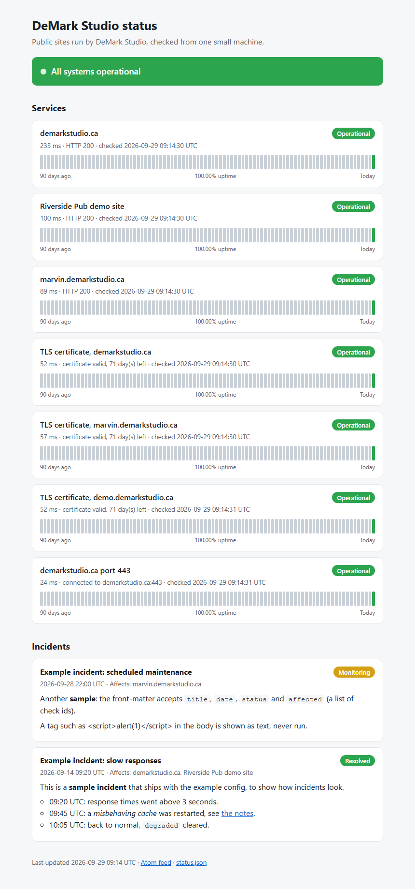

# status-page-gen

A **static status page generator** you run from cron and serve with any web server. One `index.html`, no JavaScript, no database server, nothing to install on the machines you monitor.

```
status-page-gen check -c config.yml     # probe everything, append to the history (exit 1 if something is down)
status-page-gen build -c config.yml     # write index.html + status.json + feed.xml
```



- **Three check types.** `http` (GET only, expected status, optional keyword that must appear in the body, timeout), `tcp` (can I connect to host:port) and `tls` (days left on the certificate, warn and fail thresholds).
- **Polite.** One request per check per run, sequential by default (`concurrency` up to 8), timeouts everywhere, `User-Agent: status-page-gen/1.0 (+https://github.com/dreadmoreeee/status-page-gen)`. It never logs in and never sends anything but GET.
- **One self-contained page.** Inline CSS, no JavaScript, light and dark via `prefers-color-scheme`, an overall banner, per-check status and latency, and **90 uptime bars per check** (one per UTC day, coloured by uptime, grey for days with no data, tooltip on each bar).
- **Incidents from Markdown files.** One `.md` file per incident with a small front-matter; the body supports a safe Markdown subset and is HTML-escaped.
- **Feeds.** `status.json` (current state + incidents) and an Atom `feed.xml` of incidents.
- **Small.** Python 3.10+, standard library plus PyYAML for the config (JSON configs work too).

## Install

```
pip install .            # or: python -m status_page_gen ...
```

## Config

```yaml
title: DeMark Studio status
output_dir: ../site          # relative paths are relative to this file
history: ../data/history.db
incidents_dir: incidents
timeout: 15                  # default per check, seconds
degraded_ms: 3000            # slower than this = "degraded" (0 disables)
days: 90

checks:
  - {id: main-site, name: demarkstudio.ca, type: http, url: "https://demarkstudio.ca", expect_status: 200}
  - {id: docs, name: Docs, type: http, url: "https://example.com/docs", keyword: "Getting started"}
  - {id: db, name: Database, type: tcp, host: "db.example.com:5432", timeout: 5}
  - {id: cert, name: TLS certificate, type: tls, host: "example.com", warn_days: 21, fail_days: 7}
```

| Check | Fields | up | degraded | down |
|---|---|---|---|---|
| `http` | `url`, `expect_status` (200), `keyword`, `timeout` | expected status (and keyword found) | slower than `degraded_ms` | other status, keyword missing, timeout, connection or TLS error |
| `tcp` | `host` (`name:port`) or `host` + `port`, `timeout` | connected | slower than `degraded_ms` | refused or timed out |
| `tls` | `host` (`name[:port]`, port 443), `warn_days` (21), `fail_days` (7), optional `ca_file` | more than `warn_days` left | fewer than `warn_days` left | fewer than `fail_days` left, expired, or not verifiable |

Every check needs an `id` (letters, digits, `_`, `-`) and may have a display `name`. Optional top-level keys: `description`, `base_url` (absolute links in `feed.xml`), `max_incidents` (20), `retention_days` (400), `concurrency` (1), `refresh_seconds` (300, a plain `<meta refresh>`; 0 turns it off).

## History store

Results go into a single **SQLite** file (`sqlite3` from the standard library): one row per check per run with UTC timestamp, status, latency in ms and a detail string. SQLite was chosen over JSON lines because the page needs per-day counts for 90 days times N checks, which is one indexed `GROUP BY` instead of re-reading a growing text file, and concurrent cron runs are safe. Rows older than `retention_days` are deleted on each `check`.

Uptime of a day = probes that were not `down` divided by all probes that day. A bar is green from 99.5%, amber from 95%, red below that, grey without data. Degraded probes count as reachable, but are listed in the tooltip.

## Incidents

```markdown
---
title: Database failover
date: 2026-09-20 14:30        # UTC; also 2026-09-20 or 2026-09-20T14:30:00Z
status: resolved              # investigating (default), identified, monitoring, resolved...
affected: db, main-site       # check ids, comma separated or [a, b]
---
We failed over to the replica. **No data was lost.** See [the write-up](https://example.com/post).
```

The body may use paragraphs, `#`-`###` headings, `-` lists, `**bold**`, `*italic*`, `` `code` `` and http(s) or mailto links. Anything else, including raw HTML, is escaped. Files that fail to parse are skipped with a warning.

## Cron

```
*/5 * * * * cd /opt/status && status-page-gen check -c config.yml --build -q
```

`--build` rebuilds the page even when a check is down (the exit status is still 1, so you can chain an alert after it). Point your web server at the `output_dir`.

## Measured result

Real checks against my own sites (`examples/config.yml`), three `check` runs about a minute apart (9 GET requests in total, plus TLS and TCP connects), then `build`. Run 3 of 3:

```
$ python -m status_page_gen check -c examples/config.yml
CHECK                                    STATUS  LATENCY  DETAIL
demarkstudio.ca                          UP       233 ms  HTTP 200
Riverside Pub demo site                  UP       100 ms  HTTP 200
marvin.demarkstudio.ca                   UP        89 ms  HTTP 200
TLS certificate, demarkstudio.ca         UP        52 ms  certificate valid, 71 day(s) left
TLS certificate, marvin.demarkstudio.ca  UP        57 ms  certificate valid, 71 day(s) left
TLS certificate, demo.demarkstudio.ca    UP        52 ms  certificate valid, 71 day(s) left
demarkstudio.ca port 443                 UP        24 ms  connected to demarkstudio.ca:443

$ python -m status_page_gen build -c examples/config.yml
wrote site/index.html
wrote site/status.json
wrote site/feed.xml
```

Run 1 started at 09:12:17 UTC, run 2 at 09:13:23 and run 3 at 09:14:30; all 7 checks were up every time (exit code 0). Latencies stayed between 24 ms (TCP) and 294 ms (HTTP) from my machine in Canada, and the three certificates had 71 days left. The banner read "All systems operational".

**Honest caveat:** with only three runs in one afternoon, the 90-day bars show **just today** (a single green bar per check, the other 89 are grey "no data"), and the 100.00% uptime is over those 3 probes. The two incidents in the screenshot are the sample files in `examples/incidents/`, not real events.

```
$ python -m pytest -q
..............................................................
62 passed in 25.01s
```

(The suite takes about 25 s because a few tests wait on deliberate timeouts and slow local responses.)

## Limitations

- Only as good as the machine it runs on: if the cron host is offline, nothing is recorded and the bars show grey, not red.
- No alerting, no authentication, no POST or browser-level checks; that is deliberate.
- Timeouts are per socket operation, so a very slow but steady response can take longer than `timeout` in total.
- Times are UTC; the "day" of a bar is the UTC day.

## Author

Marvin Palencia, founder of [DeMark Studio](https://demarkstudio.ca), Miramichi, New Brunswick, Canada. Portfolio: [marvin.demarkstudio.ca](https://marvin.demarkstudio.ca)

MIT License.
